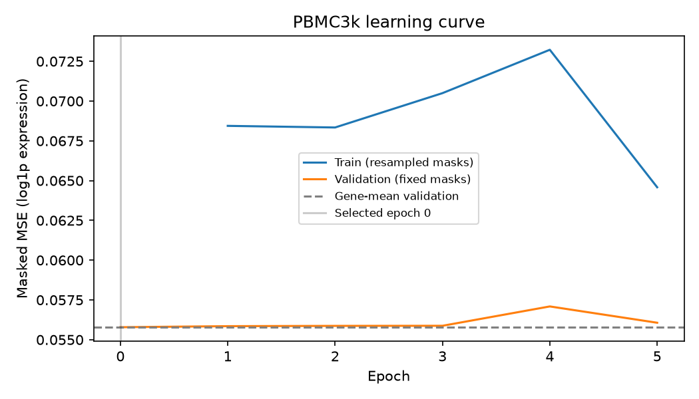

# Single-cell Transformer

[English](README.md) | 繁體中文

用 **PBMC3k + Scanpy + PyTorch** 練習單細胞資料處理與 Transformer：人為遮住已知的基因表達值，再根據同一細胞的其他基因重建它，並與「訓練集各基因平均值」比較。

這是小型學習專案。第一版已完成資料探索、訓練、固定遮蔽評估與權重重新載入；尚未包含 scGPT、cell-type annotation 或 multi-omics。原始學習規劃保留在 [docs/learning\_plan.md](docs/learning_plan.md)。

第一次閱讀可先看 [readme\_project\_TW.md](readme_project_TW.md)，用具體例子了解模型輸入、預測目標、程式流程與輸出。

## 快速開始

已在 **macOS arm64、Python 3.11.2、CPU** 實際執行。`requirements.txt` 固定本次使用的直接依賴版本；相容版本範圍在 `pyproject.toml`。

在專案根目錄執行：

```bash
python3 -m venv singlecell-venv
source singlecell-venv/bin/activate
python -m pip install --upgrade pip
python -m pip install -r requirements.txt
python -m pip install --no-deps -e .
jupyter lab
```

依序開啟並執行：

1. [01\_data\_exploration.ipynb](notebooks/01_data_exploration.ipynb)：認識矩陣與 metadata、QC、counts 與 log1p、PCA／UMAP。
2. [02\_masked\_expression\_transformer.ipynb](notebooks/02_masked_expression_transformer.ipynb)：切分、Tensor 形狀、遮蔽、forward／backward、完整訓練、基準比較與載入權重。

兩份 Notebook 含繁體中文說明與實際執行輸出。Jupyter 請選擇上述環境的 Python 3 kernel。首次執行需要連線下載約 6 MB 的 PBMC3k，之後使用本機快取。

也可以直接執行：

```bash
python -m singlecell_baseline.explore
python -m singlecell_baseline.train
python -m pytest -q
```

訓練預設為 5 epochs、128 genes、batch size 16、seed 42。其他實驗可另存，避免覆寫本版結果：

```bash
python -m singlecell_baseline.train --epochs 10 --output outputs/experiment_02
```

可明確指定 `--device mps`；啟動前會檢查是否可用。本版只驗證 CPU，未驗證 MPS 訓練。

## 第一版實際結果

2026-10-23 執行。原始資料為 **2,700 cells × 32,738 genes**；固定 QC 後保留 **2,638 cells**，切分為 train **1,846**、validation **396**、test **396**。模型使用 train 選出的 128 個基因，共 **12,769** 個可訓練參數。

5 epochs 均未優於平均值基準的 validation MSE，因此選定 **epoch 0**。模型以 train gene mean 加上零初始化的 residual head 起步，epoch 0 正好等於平均值基準；以下是所選 checkpoint 的結果，**不是已訓練模型超越基準的證據**。

| Test 遮蔽位置 |   位置數 | Gene mean MAE | Transformer MAE | Gene mean RMSE | Transformer RMSE |
| --------- | ----: | ------------: | --------------: | -------------: | ---------------: |
| 全部        | 7,524 |      0.066361 |        0.066361 |       0.250510 |         0.250510 |
| 原本為零      | 7,376 |      0.033832 |        0.033832 |       0.039179 |         0.039179 |
| 原本非零      |   148 |      1.687506 |        1.687506 |       1.764610 |         1.764610 |

誤差的單位是處理後的 log1p 表達值。被遮蔽位置中約 98% 為零，整體低誤差掩蓋了非零值的重建困難。短訓練與目前的 HVG 選擇尚未帶來 validation 改善；後續應先在 train／validation 檢查特徵與設定，再進行新的評估。



完整結果：[evaluation.csv](outputs/metrics/evaluation.csv)、[results.json](outputs/metrics/results.json)、[history.csv](outputs/metrics/history.csv)。訓練函式會驗證儲存前後的 test 預測完全相同。測試涵蓋切分與 train-only 擬合、遮蔽值不洩漏、分組指標、離線小型訓練與 checkpoint 載入。

## 資料與評估設計

- **QC：**&#x5075;測基因數至少 200、少於 2,500，粒線體 counts 比例低於 5%。這些是 PBMC 教學的起步門檻，逐細胞套用，不由 held-out 統計量決定；不是通用的品質規則。
- **先切分，再擬合：**&#x57FA;因至少被 3 個 train 細胞偵測到，之後僅用 train 計算 Seurat normalized dispersion，穩定排序取前 128 個。train gene means 也只來自 train。validation/test 保持同樣的 gene vocabulary 與順序。
- **數值處理：**&#x4FDD;留原始 counts；每個細胞以完整 library 總量縮放到 10,000，再取 `log1p`，最後取模型基因子集。此固定逐細胞轉換不需要擬合 scaler。
- **遮蔽：**&#x6BCF;個細胞隨機遮住 19/128 個位置，零與非零值均可被選中。模型的輸入端會清除遮蔽值，並附加獨立的 bool mask；原始 target 另存，MSE 只計算遮蔽位置。
- **公平比較：**&#x74;rain masks 每個 batch 重新抽樣；validation/test masks 以 seed 43/44 固定。Transformer 與平均值基準使用相同 targets 和 masks。validation MSE 選權重，test 在選完後評估。

模型為 `gene embedding + value/mask encoding → Transformer Encoder → scalar head`，再加回 train gene mean 作為 residual 預測。預設 embedding dimension 32、4 heads、1 layer、dropout 0.1、AdamW learning rate 0.001。沒有 positional encoding、padding 或 causal mask。

| 張量                                 | 形狀（B：batch；G：genes；D：embedding） |
| ---------------------------------- | ------------------------------- |
| 表達值／target／bool mask               | `(B, G)`，預設 `(16, 128)`         |
| 數值與遮蔽標記                            | `(B, G, 2)`                     |
| Gene／value embedding 相加、Encoder 輸出 | `(B, G, D)`，預設 `(16, 128, 32)`  |
| 預測值                                | `(B, G)`                        |

完整原始資料只用稀疏矩陣；模型僅把選出的 128 個基因轉為 dense。來源、SHA-256、QC、基因清單、細胞切分、超參數與套件版本都保存在 `outputs/metrics/`。

## 檔案與產物

```text
notebooks/                 # 兩份教學 Notebook（含實際輸出）
singlecell_baseline/        # data.py / model.py / train.py / explore.py
tests/                     # 不需下載資料的正確性測試
data/                      # 來源說明；raw/、processed/ 不納入 Git
outputs/figures/            # QC、PCA、UMAP、學習曲線
outputs/metrics/            # JSON、CSV 設定與實際結果
outputs/checkpoints/        # 本機 best.pt，不納入 Git
docs/learning_plan.md       # 原始學習計畫
.github/workflows/          # GitHub Actions：CPU 離線測試
```

`outputs/checkpoints/best.pt` 包含 state dict、依序排列的基因、前處理與模型設定。重新跑訓練即可重建，無須將權重或資料上傳 GitHub。`.gitignore` 也排除虛擬環境、快取與 secrets；圖表、小型評估檔與 Notebook 保留，方便直接瀏覽。

```python
from singlecell_baseline.train import load_checkpoint

model, checkpoint = load_checkpoint("outputs/checkpoints/best.pt")
genes = checkpoint["genes"]  # 新輸入必須使用完全相同的基因順序與前處理
```

## 解讀範圍與下一步

這是完整量測資料**預處理後**的人工遮蔽重建；正規化先於遮蔽，不代表能從原始缺失 counts 恢復真實訊號。PBMC3k 沒有在此使用獨立 cell-type 標籤；PCA／UMAP 與 attention 都不能單獨證明生物機制。單一 donor 的隨機細胞切分也不代表跨 donor 或跨資料集泛化。

後續可先在 validation 上比較特徵選擇、訓練長度與非零位置表現，之後再考慮 scGPT embedding／微調與 multi-omics。本版先保留小而可讀、能重跑的流程。

資料與 API 參考：[Scanpy PBMC3k](https://scanpy.scverse.org/en/stable/generated/scanpy.datasets.pbmc3k.html)、[Scanpy HVG](https://scanpy.scverse.org/en/stable/generated/scanpy.pp.highly_variable_genes.html)、[PyTorch TransformerEncoder](https://docs.pytorch.org/docs/stable/generated/torch.nn.TransformerEncoder.html)。程式與說明採 MIT 授權；資料依原始提供者條款，見 [data/README.md](data/README.md)。
